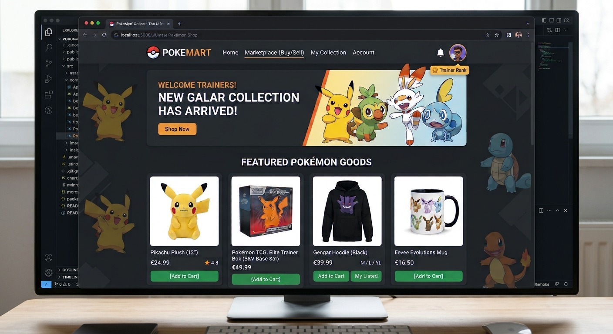

<h1 align="center">Tienda Pokémon</h1>

  

  Backend de una tienda de Pokémon con Spring Boot, 
  organizado en <em>vertical slices</em> y Clean Architecture.

  
  
  

---

## Sobre el proyecto

Tienda Pokémon gestiona el catálogo de una tienda online de Pokémon a través de una API web. Está pensada para crecer por áreas de negocio (usuarios, compras, ventas…) sin tocar las que ya existen.

Es un proyecto académico de DAW desarrollado en equipo.

## Funcionalidades

| Funcionalidad     | Endpoint                |
|-------------------|-------------------------|
| Crear Pokémon     | `POST /pokemons`        |
| Listar Pokémon    | `GET /pokemons`         |
| Editar Pokémon    | `PUT /pokemons/{id}`    |
| Eliminar Pokémon  | `DELETE /pokemons/{id}` |

## Tecnologías

| Tecnología                  | Por qué                                                              |
|-----------------------------|----------------------------------------------------------------------|
| **Java 17**                 | Versión mínima que exige Spring Boot 4                               |
| **Spring Boot 4.1.1** (Web MVC) | Servidor web, rutas e inyección de dependencias ya integrados    |
| **Lombok**                  | Elimina código repetitivo: getters, constructores y builders         |
| **Maven**                   | Gestión de dependencias y construcción, con wrapper para no instalarlo |

## Diseño

- **Vertical slicing:** una carpeta por área de negocio, para añadir usuarios, compras o ventas sin tocar lo que ya existe.
- **Clean Architecture:** el negocio no depende de Spring, de HTTP ni de la base de datos, así que la tecnología puede cambiar sin reescribirlo.

## Documentación

| Documento                                          | Contenido                                |
|----------------------------------------------------|------------------------------------------|
| [Guía de usuario](documentation/guiadeusuario.md)  | Puesta en marcha y uso de la aplicación  |
| [Arquitectura](documentation/arquitectura.md)      | Qué decisiones tomamos, por qué y dónde  |
| [Guía de trabajo](documentation/guiadetrabajo.md)  | Cómo añadir funcionalidades al proyecto  |
