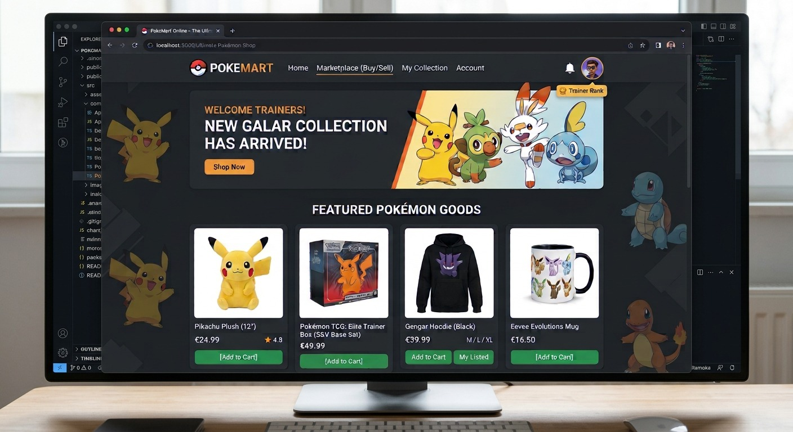

<h1 align="center">Tienda Pokémon</h1>

  

  API web para gestionar el catálogo de una tienda de Pokémon, 
  construida con Spring Boot, <em>vertical slicing</em> y Clean Architecture.

  
  
  
  

---

## Sobre el proyecto

Tienda Pokémon gestiona el catálogo de una tienda online de Pokémon a través de una API web. Está pensada para crecer por áreas de negocio (usuarios, compras, ventas…) sin tocar las que ya existen, y para cambiar la forma de almacenar los datos sin tocar la lógica de negocio.

## Funcionalidades

| Funcionalidad     | Endpoint                | Detalle                                      |
|-------------------|-------------------------|----------------------------------------------|
| Crear Pokémon     | `POST /pokemons`        | Valida los datos y asigna el identificador   |
| Listar Pokémon    | `GET /pokemons`         | Devuelve el catálogo completo                |
| Editar Pokémon    | `PUT /pokemons/{id}`    | Actualiza la foto y el precio                |
| Eliminar Pokémon  | `DELETE /pokemons/{id}` | Elimina el Pokémon indicado                  |

Todos los errores se devuelven con el mismo formato y el código HTTP que corresponde (400, 404 o 500).

## Tecnologías

| Tecnología                       | Por qué                                                                               |
|----------------------------------|---------------------------------------------------------------------------------------|
| **Java 17**                      | Versión mínima que exige Spring Boot 4                                                |
| **Spring Boot 4.1.1** (Web MVC)  | Servidor web, rutas e inyección de dependencias ya integrados                         |
| **Spring Boot Validation**       | Reglas de entrada declarativas, con mensajes propios y validadores a medida           |
| **MapStruct 1.6.3**              | Mappers generados en compilación, sin reflexión: un mapeo roto no compila             |
| **Lombok**                       | Elimina código repetitivo: getters, constructores y builders                          |
| **Maven**                        | Gestión de dependencias y construcción, con wrapper para no instalarlo                |

## Decisiones de diseño

- **Vertical slicing:** una carpeta por área de negocio, para añadir usuarios, compras o ventas sin tocar lo que ya existe.
- **Clean Architecture:** el negocio no depende de Spring, de HTTP ni de la base de datos, así que la tecnología puede cambiar sin reescribirlo.
- **Repositorios como contrato del dominio:** los casos de uso no saben dónde se guardan los datos. Hoy es en memoria; mañana puede ser una base de datos sin tocarlos.
- **Validación en el borde y errores centralizados:** los datos incorrectos no pasan del controlador, y todos los errores se traducen a HTTP en un único punto.

El razonamiento completo está en [Arquitectura](documentation/arquitectura.md).

## Documentación

| Documento                                          | Contenido                                |
|----------------------------------------------------|------------------------------------------|
| [Guía de usuario](documentation/guiadeusuario.md)  | Puesta en marcha y uso de la aplicación  |
| [Arquitectura](documentation/arquitectura.md)      | Qué decisiones tomamos, por qué y dónde  |
| [Guía de trabajo](documentation/guiadetrabajo.md)  | Cómo añadir funcionalidades al proyecto  |
