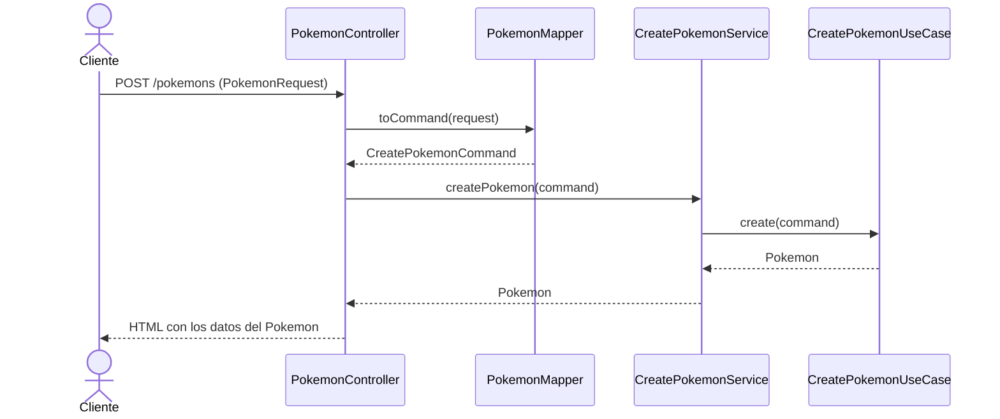
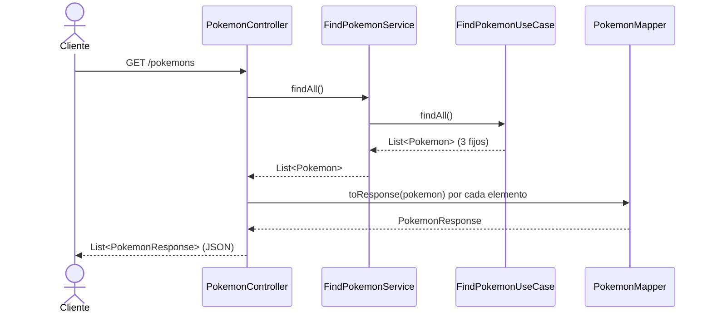

# Store: tienda de Pokemon

Aplicación web con Spring Boot para gestionar las operativas de una tienda de Pokemon. El objetivo de la práctica es aplicar **Vertical Slicing** y **Clean Architecture** sobre un caso sencillo: crear un Pokemon (`POST`) y listarlos (`GET`).

## Requisitos y arranque

- Java 17
- Maven (o el wrapper `./mvnw` incluido)
- Spring Boot 4.1.1, con Spring Web y Lombok

```bash
./mvnw spring-boot:run
```

Con la aplicación arrancada:

- Formulario de creación: <http://localhost:8080/formulario-crear-pokemon.html>
- Listado: <http://localhost:8080/pokemons>

## Endpoints

| Método | URL         | Entrada                                  | Salida                         |
|--------|-------------|------------------------------------------|--------------------------------|
| POST   | `/pokemons` | Formulario: nombre, tipo, foto, precio   | Página HTML con el Pokemon creado |
| GET    | `/pokemons` | Ninguna                                  | Lista de `PokemonResponse` (JSON) |

## Arquitectura

### Organización: Vertical Slicing

El código se divide por **área de negocio** (`pokemon`, y en el futuro usuarios, compras...) y no por capas técnicas. Así, una nueva característica no obliga a tocar las existentes y el mantenimiento de cada área es independiente.

### Capas dentro de cada slice: Clean Architecture

```
src/main/java/es/etg/daw/dawes/store/
├── domain/
│   └── model/            Pokemon (entidad de negocio, sin frameworks)
├── application/
│   ├── command/          CreatePokemonCommand (datos de entrada del caso de uso)
│   ├── usecase/          CreatePokemonUseCase, FindPokemonUseCase (lógica)
│   └── service/          Servicios que orquestan los casos de uso
└── infraestructure/
    ├── config/           PokemonConfig (definición de beans)
    ├── mapper/           PokemonMapper (conversión entre capas)
    └── web/mvc/
        ├── controller/   PokemonController
        └── dto/          PokemonRequest, PokemonResponse (records)
```

**Regla de dependencias:** `infraestructure → application → domain`. El dominio no conoce nada de fuera; la aplicación solo conoce el dominio; la infraestructura conoce a las dos.

### Por qué hay varias clases con campos parecidos

`Pokemon`, `PokemonRequest`, `CreatePokemonCommand` y `PokemonResponse` se parecen, pero cada una cambia por una razón distinta:

| Clase                  | Capa            | Representa                                  |
|------------------------|-----------------|---------------------------------------------|
| `PokemonRequest`       | infraestructura | Lo que llega por HTTP                       |
| `CreatePokemonCommand` | aplicación      | Lo que necesita el caso de uso para crear   |
| `Pokemon`              | dominio         | El concepto de negocio (con `id`, `createdAt`) |
| `PokemonResponse`      | infraestructura | Lo que se decide mostrar al exterior        |

Separarlas evita que un cambio en el formulario afecte al dominio, y que datos internos se filtren en la respuesta. El `PokemonMapper` hace las conversiones.

### Inyección de dependencias

Las clases `application` no llevan anotaciones de Spring para no depender del framework. Es `PokemonConfig` (infraestructura) la que declara los `@Bean`, y Spring se los entrega por constructor a quien los necesita (`@RequiredArgsConstructor` de Lombok). Nadie hace `new` de sus dependencias.

## Flujo de las peticiones

### POST `/pokemons`



### GET `/pokemons`

> Ajustar los nombres de las clases a los usados realmente en la implementación.



## Notas de interés

- **Error de arranque por bean no encontrado.** Al ejecutar por primera vez, Spring no podía instanciar `CreatePokemonService` porque `CreatePokemonUseCase` no estaba registrado como bean. Se resuelve declarándolo en `PokemonConfig`. Esto es intencionado: el caso de uso no usa `@Service` para mantener la capa de aplicación libre de Spring.
- **Paquetes del enunciado corregidos.** `PokemonMapper` importaba los DTOs desde `web.dto` cuando están en `web.mvc.dto`; se han alineado los paquetes. [COMPLETAR: otras correcciones que hayas hecho]
- **`@ResponseBody` en el GET.** Como `PokemonController` es un `@Controller`, el método que devuelve la lista necesita `@ResponseBody` para serializarse como JSON y no buscar una vista. [COMPLETAR: confirmar qué solución has usado]
- **Decisiones propias en el listado.** [COMPLETAR: cómo has montado `FindPokemonUseCase`, dónde has registrado los beans nuevos, si has tenido que tocar el mapper...]

## Limitaciones conocidas

- Los datos del listado son **estáticos** (tres Pokemon fijos); no hay persistencia.
- El POST crea el `Pokemon` pero **no lo almacena**, y su `id` queda en `0`.
- La respuesta del POST es HTML escrito dentro del controlador; está previsto sustituirlo por plantillas.
- El servicio actual solo reenvía la llamada al caso de uso; cobrará sentido cuando coordine varios.

## Más documentación

- [Cómo añadir una feature nueva](docs/anadir-feature.md)

## Flujo de trabajo en equipo

Se usa Git Flow: `main`, `develop` y ramas `feature/*` por caso de uso (por ejemplo `feature/pokemon-create`, `feature/pokemon-list`). Los ficheros compartidos (`PokemonController`, `PokemonMapper`, `PokemonConfig`) son los que más conflictos generan; conviene integrar `develop` con frecuencia.